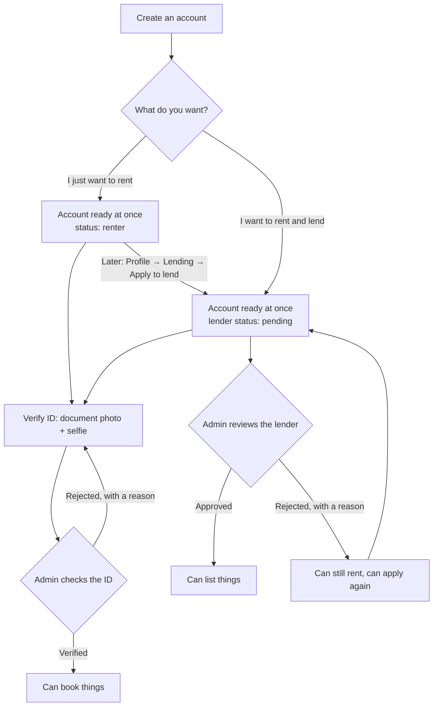
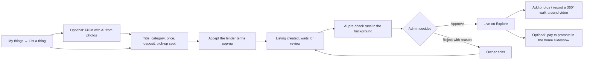
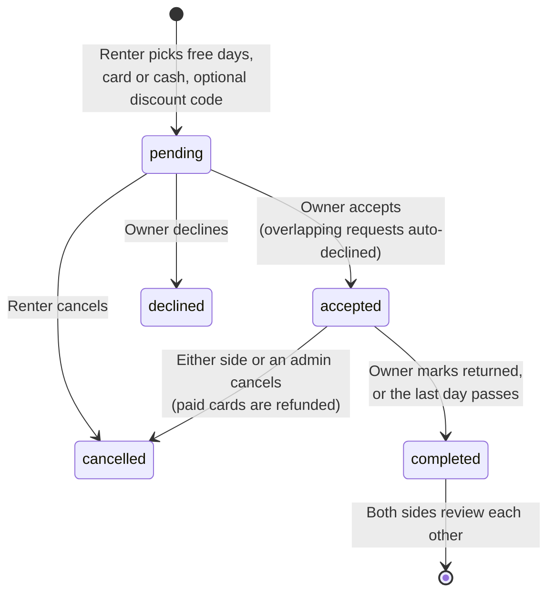

# Rentify

**Borrow it from next door.** Rentify is a neighbourhood rental marketplace. People rent out tools, cameras,
tents, bikes and other things by the day. Renters can look at every item in **360°** before they book. The
backend handles availability calendars, booking requests, payments, chat and reviews, and admins moderate it all.

Built in 48 hours for a hackathon.

| | |
|---|---|
| **App** | React Native (Expo SDK 58, TypeScript, React Navigation). Runs in any phone browser, in Expo Go, or on the iOS and Android simulators |
| **API** | Python FastAPI + SQLAlchemy 2, Socket.IO for live chat and notifications |
| **Database** | SQLite (`backend/rentathing.db`) |
| **Admin** | Desktop web console at `/admin` (plain HTML/CSS/JS) plus a small admin area inside the phone app |
| **360° view** | OpenCV cuts a walk-around video into 36 frames, and a custom spin viewer plays them back |
| **AI** | Gemini (free), Groq (free) or Claude Haiku: fills in listings from photos and pre-checks listings for admins |
| **Payments** | Stripe Checkout in test mode, or a built-in demo checkout, or cash |

---

## Contents

1. [Quick start for judges](#quick-start-for-judges)
2. [Demo accounts and roles](#demo-accounts-and-roles)
3. [Roles and permissions](#roles-and-permissions)
4. [Workflows](#workflows)
5. [Every feature](#every-feature)
6. [2-minute demo script](#2-minute-demo-script)
7. [Run it yourself](#run-it-yourself)
8. [Configuration](#configuration)
9. [API overview](#api-overview)
10. [Project structure](#project-structure)
11. [Tests, CI/CD and security](#tests-cicd-and-security)

---

## Quick start for judges

1. Open the app: **`http://<host>:8000`**. On a laptop it shows inside a phone frame, and on a phone it fills the screen.
2. On the login screen tap **Explore with a demo account**. You are now Sam, a verified renter and lender.
3. To see the admin side, log out and tap **Demo admin**, or open **`http://<host>:8000/admin`** on a computer.
4. To pay by card, use Stripe's test card **`4242 4242 4242 4242`** with any future date and any CVC.
   `4000 0000 0000 0002` shows a declined payment.

API documentation (Swagger) is at **`http://<host>:8000/docs`**.

---

## Demo accounts and roles

Every demo account below is created by `backend/seed.py`.

| Name | Email | Password | Role | State after a fresh seed | Good for showing |
|---|---|---|---|---|---|
| **Sam Rivera** | `demo@rentathing.app` | `demo1234` | Renter + approved lender | ID **verified** automatically | The main demo: browsing, booking, paying, chat, listing, promoting. One-tap button on the login screen |
| **Robin Admin** | `admin@rentathing.app` | `admin1234` | **Admin** | ID verified automatically | Web admin console and the phone admin area. One-tap "Demo admin" button on the login screen |
| **Alice Chen** | `alice@rentathing.app` | `demo1234` | Renter + approved lender | ID **not** verified | The other side of a booking (owner of the camera Sam rented). Has to verify her ID before she can book or list |
| **Bob Okafor** | `bob@rentathing.app` | `demo1234` | Renter + approved lender | ID not verified | Neighbour with listings and a support message in the admin inbox |
| **Carla Diaz** | `carla@rentathing.app` | `demo1234` | Renter + approved lender | ID not verified | Sends one of the overlapping requests for Sam's drill. Has a safety report in the admin inbox |
| **Dan Park** | `dan@rentathing.app` | `demo1234` | Renter, **lender waiting for approval** | ID not verified | The approval queue: a pending lender with a listing waiting for review |
| **Mia Lopez** | `mia@rentathing.app` | `demo1234` | Renter, **lender waiting for approval** | ID not verified | A second pending lender in the approval queue |

Notes:

- These are **demo credentials for a test environment**. Change or remove them before any real launch.
- On the running hackathon server some states may differ from a fresh seed because the demo has been used
  (for example an admin may have suspended or rejected someone). An admin can change any of this in the web console.
- You can create your own account from **Create an account**. Pick **"I just want to rent"** to go straight into the
  app, or **"I want to rent and lend"** to also apply as a lender.
- Make any account an admin from the web console (**Users → Make admin**), or with
  `sqlite3 backend/rentathing.db "update users set is_admin=1 where email='you@example.com'"`.

---

## Roles and permissions

| Can do | Visitor (logged out) | Renter (just signed up) | Renter with verified ID | Lender waiting for approval | Approved lender (ID verified) | Admin |
|---|:-:|:-:|:-:|:-:|:-:|:-:|
| See the login and sign-up screens | ✓ | ✓ | ✓ | ✓ | ✓ | ✓ |
| Browse Explore, search, 360° view, calendars | | ✓ | ✓ | ✓ | ✓ | ✓ |
| Request a booking and pay | | needs ID check | ✓ | needs ID check | ✓ | ✓ |
| Chat with the other person on a booking | | ✓ | ✓ | ✓ | ✓ | ✓ (reads as moderator) |
| Leave reviews after a rental | | ✓ | ✓ | ✓ | ✓ | ✓ |
| List things for rent | | apply first | apply first | waits for admin | ✓ | ✓ |
| Accept / decline requests, block dates | | | | | ✓ | ✓ |
| Promote a listing in the home slideshow | | | | | ✓ | ✓ |
| Rent Club chat (after 5 completed rentals) | | when a member | when a member | when a member | when a member | ✓ (moderator) |
| Admin console and phone admin | | | | | | ✓ |

The two checks, explained:

- **Lender approval** (by an admin). Renting never needs admin approval. Listing things does. People pick
  "rent and lend" at sign-up, or apply later from **Profile → Lending** or by tapping **List a thing**.
  The admin setting *Approve new lenders* can switch this off, and then applications are approved at once.
- **ID verification** (by an admin). Everyone uploads a photo of an ID card, passport or driving licence plus a
  selfie once. Booking and listing are locked until an admin approves the ID. Admins and the demo account are
  verified automatically. The admin setting *Require ID verification* can switch this off.
- **Suspended** users can't log in. Their listings are hidden and their open requests are cancelled.

---

## Workflows

### 1. Sign-up: renter or lender



### 2. Listing a thing



### 3. Booking, payment and return



Around the booking:

- **Payment.** Card: the renter pays online once the owner accepts (Stripe test mode or the demo checkout).
  Cash: the owner taps **Cash received** at pick-up.
- **Chat** opens as soon as a request is sent and is live for both people.
- **Reminders**: pick-up reminder the day before, return reminder on the last day, for both people.
- **Handover photos**: both people can add up to 6 photos at pick-up and 6 at return as a record of condition.
- **Reviews**: after completion each side reviews the other once. Item ratings come from renters' reviews.
- **Rent Club**: after 5 completed rentals the renter joins the club (gold badge and members' chat).

### 4. Promoting a listing

Owner taps the megaphone on a live listing → picks a plan and optional headline → pays by card → the order
waits for an admin → approved: it appears in the home slideshow as "Sponsored". Rejected: automatic refund
and the owner sees the reason.

### 5. Admin moderation

Admin opens `/admin` → **Overview** shows what needs attention → **Approvals** (lenders and listings, one by one or
in bulk, with AI pre-check results) → **ID checks** → **Promotions** → **Support inbox**. Every action is
recorded in the **Audit log** with who, what and why.

---

## Every feature

### Accounts and profile
- Email and password sign-up and login (JWT tokens, valid 7 days, minimum 8-character password).
- **Renter-only or renter + lender** choice at sign-up. Renters go straight in; lenders need admin approval to list.
- **Apply to lend later** from Profile → Lending or from "List a thing". Shows "being reviewed" or "apply again".
- One-tap **demo login** and **demo admin** buttons on the login screen.
- Profile with photo, name, neighbourhood and bio. Stats: rating, listed, borrowed, lent out. Reviews from neighbours.
- Public profiles of other users with their rating and reviews.
- Edit profile, upload a profile photo, change password, delete account (data anonymised).
- Account banner that tells you what's missing: verify your ID, or your lender application is being reviewed or was rejected.
- Badges: blue **ID verified** shield, gold **Rent Club** badge, shown on profiles, listings, bookings and chats.

### Explore and search
- Home screen with greeting, search card and quick filters: **This weekend**, **Under €15**, **Top rated**.
- **13 categories** with colour tiles: Tools & DIY, Garden, Camping, Bikes & scooters, Photo & video, Electronics,
  Party & events, Sports, Kids & baby, Home & cleaning, Music, Travel, Other.
- Text search, category filter, "has 360° view" filter, and availability filter by dates.
- **Home city: Prishtina.** Items within 12 km of the city centre (or whose location mentions the city in any
  common spelling) are listed first. Items outside get an "outside Prishtina" chip and a warning to check the
  pick-up place. The city can be changed with the `HOME_CITY_*` environment variables.
  In the demo data, the tent (Peja) and the projector (Prizren) show this note.
- **Home slideshow** (swipeable, auto-advancing): Black Friday slide in season, sponsored listings, "Get seen first"
  and "List a thing" slides.
- "Popular near you" photo carousel, **Free this weekend** shelf, and big photo feed cards.
- **Promo pop-ups** (house ads): Black Friday, promote a listing, Rent Club progress, this weekend, list a thing.
  Never on the first visit, at most once every 20 hours, not while searching. Add `?popup=1` to the URL to see one at once.

### Item page
- Photo gallery and the **360° spin viewer**: drag to walk around, flick to spin with momentum, idle auto-rotate,
  fullscreen, and **twist-your-phone gyroscope mode** on native.
- Price per day, deposit, description, owner card with rating and badges, item reviews.
- **Availability calendar**: booked and blocked days, days with pending requests, pick a date range.
- **Map** of the pick-up area with "Get directions". The public sees an approximate area (~500 m, street hidden).
  The owner, admins and renters with a confirmed booking see the exact pin.
- **Request to rent** sheet: dates, message to the owner, card or cash, discount code field (one-tap apply for the
  featured code). Shows "Verify ID" instead when the renter isn't verified yet.

### Listing things (lenders)
- Create, edit, hide from Explore / show again, and delete listings with title, category, description, price per day, deposit and pick-up spot.
- **Pick-up location**: address search (OpenStreetMap, via the backend) or "use my current location".
- **Lender terms pop-up** every time a new item is added. The API refuses listings without accepted terms.
- **Fill in with AI**: pick 1 to 4 photos and the AI suggests title, category, description, daily price and deposit.
  The owner checks everything before saving, and the photos are added automatically.
- Upload and remove photos.
- **360° view**: record a ~15 s walk-around video (or upload 8+ photos in order). The server cuts 36 frames with OpenCV.
- **Blackout dates**: owners block days when the item isn't available.
- **My things** screen: live and not-live counts, review status per listing (pending / rejected with reason),
  promotion status and days left.
- Service-fee hint in the editor, including special fee periods (for example a lower fee on Black Friday).

### Bookings
- Booking requests with statuses pending → accepted → completed, or declined / cancelled.
- Overlap rules: a request can't overlap an accepted booking or a blackout. Pending requests don't block, so
  several people can ask for the same days. **Accepting auto-declines overlapping requests.**
- Maximum rental length 60 days; no booking your own item or dates in the past.
- **Bookings** tab with "Borrowing" and "Lending" sections, accept, decline, cancel, mark as returned, cash received.
- Accepted rentals whose last day has passed become completed automatically.
- **Handover photos**: up to 6 pick-up and 6 return photos per person, from the day before pick-up until 3 days after.
  Can be removed within 15 minutes, then they stay as a record. The other person is notified.
- **Pick-up and return reminders** sent automatically (background job every 10 minutes, once per booking).
- **Reviews** both ways after completion, one per side, with stars and a comment.

### Payments, fees and discounts
- **Card or cash** for each booking.
- Card payments through **Stripe Checkout in test mode** (with a `sk_test_` key) or a built-in **demo checkout**
  that accepts Stripe test cards. Live keys are refused on purpose.
- Automatic **refunds** when a paid booking is cancelled by the renter, the owner or an admin.
- **Service fee** (default 10%) is taken from the owner's payout. Renters pay the listed price.
- **Special fee periods** set by admins: one-off or yearly, with presets for Black Friday, Summer and Christmas.
  The period that contains the rental start date applies; if several overlap, the shortest wins.
- **Discount codes**: % off, optional € cap, minimum rental days, start and end dates, total uses, once per person.
  Rentify pays the discount, so owners still get their full payout. One code can be "featured" in the Black Friday ads.
- Euro prices throughout.

### Chat and notifications
- **Live chat per booking** over Socket.IO with a typing indicator, *Seen* receipts, quick replies and an HTTP fallback.
- **Messages** inbox listing all conversations, with unread counts.
- **Notifications** for new requests, accept / decline / cancel, payments, returns, reviews, messages, handover
  photos, reminders, promotion decisions and joining the Rent Club.
- Live **glass banner** that slides in when something happens, plus badges on the tab bar and Explore icons.

### Rent Club
- Join automatically after **5 completed rentals** (admins can also grant membership).
- Gold badge everywhere and a live **members-only group chat**. Non-members see their progress (x/5).

### ID verification
- Upload a photo of an ID card, passport or driving licence plus a selfie.
- Photos are re-encoded, stored outside the public media folder, visible only to admins, and **deleted as soon as
  an admin decides**.
- Status: not verified → being checked → verified, or rejected with a reason and a "try again" path.

### Support and legal
- **Contact us** form with topics (question, a booking, safety, bug, idea), saved to the admin support inbox.
- **Report a safety issue** shortcut. Help & FAQ, Terms of Service, Privacy Policy, Rental rules, About.

### Design
- iOS-style app with a floating **liquid-glass tab bar** (frosted blur and a sliding glass lens), glass buttons over
  photos and a floating booking bar.
- Warm "marketplace" look: cream and espresso colours with a terracotta accent and pastel category colours.
- **Light, Dark or Automatic** theme plus **5 accent colours** (Profile → Appearance), remembered on the device.
- Phone frame on desktop browsers. Works on Samsung Internet, Chrome and Safari.

### Admin: desktop web console (`/admin`)
| Page | What it does |
|---|---|
| **Overview** | Key numbers and a chart, platform fees earned, discounts given, links to anything waiting |
| **Approvals** | Lender applications and new listings. Approve one by one or select several. Rejections need a reason the user sees. Shows the AI pre-check |
| **ID checks** | View ID photo and selfie side by side, verify or reject with a reason |
| **Promotions** | Paid promotion orders: approve (goes live) or reject (automatic refund) |
| **Users** | Search and filter (pending lenders, rejected lenders, admins, suspended). Approve or reject lenders, suspend / reinstate, make admin, grant Rent Club |
| **Listings** | Search all listings, hide / restore, approve / reject, see the AI check |
| **Bookings** | All bookings with payment state, handover photos, discount used; cancel with refund |
| **Reviews** | Read and remove reviews |
| **Support inbox** | Contact messages with internal notes, reply by email, resolve / reopen |
| **Service fees** | Normal fee and special fee periods with presets and a fee preview for any date |
| **Discount codes** | Create, pause, edit and feature codes, with presets (Black Friday week, Cyber Monday, Welcome 10%) |
| **Audit log** | Every admin action with who, what, when and why |
| **Settings** | Approve new lenders, approve new listings, require ID verification, platform fee |

### Admin: inside the phone app
Profile → **Admin dashboard** (admins only): key numbers, an approvals screen with tabs for listings, people and
promotions, the support inbox, and a link to the desktop console.

### AI features (optional)
1. **Fill in with AI** for new listings (photos → listing draft). Limited to 30 per user per hour.
2. **AI pre-check** of every listing waiting for review: *Looks fine / Check this / Likely reject*, the issues found,
   and a suggested rejection message. The admin always makes the final decision.

Only listing photos and text are sent to the AI, never names, emails or addresses. Without an API key the app works
normally and these buttons are hidden.

### Platform
- Live updates over Socket.IO (JWT in the handshake, one room per user).
- Rate limiting per IP, chat flood limit (20 messages per 10 s), upload size limits (10 MB photos, 150 MB videos),
  security headers and a content security policy.
- Database upgrades itself: new columns are added to existing databases on start.
- Docker image, GitHub Actions CI, and `phone.sh` to open the app on any phone through a Cloudflare tunnel.

---

## 2-minute demo script

1. **Sign-up choice.** Tap *Create an account* to show "I just want to rent" vs "I want to rent and lend". Go back.
2. **Log in as demo** (Sam). Explore shows the slideshow, categories and neighbours' things.
3. **Open an item** with a 360° view. Drag to walk around it, flick to spin, open fullscreen.
4. **Book it.** Pick free days on the calendar, choose **Card**, try the code **BLACKFRIDAY** if it's live, send.
5. **Bookings → Lending.** Two neighbours want Sam's drill on overlapping days. **Accept** one and the other is
   declined automatically. Open the **chat** and send a message.
6. **Pay** an accepted booking with `4242 4242 4242 4242`. Add a **handover photo**. Leave a **review** on a finished rental.
7. **My things → List a thing → Start with photos** to show the AI fill-in (needs an AI key), the lender terms and
   the 360° video upload.
8. **Admin.** Open `/admin` as Robin: approve Dan as a lender, approve his listing (with the AI pre-check), check an ID,
   approve a promotion, look at the audit log.

---

## Run it yourself

### Backend (API, web app and admin)

```bash
cd backend
python3.13 -m venv .venv && .venv/bin/python -m pip install -r requirements.txt
.venv/bin/python seed.py
.venv/bin/python -m uvicorn app.main:app --host 0.0.0.0 --port 8000 --reload
```

- `seed.py` **wipes the database** and creates the demo data. `seed.py --upgrade` adds demo data without wiping.
- API docs: `http://localhost:8000/docs`. Admin console: `http://localhost:8000/admin`.

### App in a browser (easiest, works on any phone)

```bash
cd mobile
npm install
npx expo export --platform web
```

The server serves the built app from `mobile/dist`. Restart it after the first build, then open
`http://<your-computer-ip>:8000` on a phone on the same Wi-Fi (`ipconfig getifaddr en0` on a Mac shows the IP).

### App as a native app (Expo Go)

```bash
cd mobile
npx expo start
```

Scan the QR code from inside Expo Go. Press `i` for the iOS simulator or `a` for Android.
To point the app at another server: `EXPO_PUBLIC_API_URL=https://example.trycloudflare.com npx expo start`.

### From anywhere

`./phone.sh` starts the API, opens a Cloudflare tunnel and starts Expo with the right API address, so a phone on any
network can open the app.

### Docker

```bash
docker build -t rentify .
docker run -p 8000:8000 -e SECRET_KEY=change-me -v rentify-data:/data rentify
```

---

## Configuration

Copy `backend/.env.example` to `backend/.env`. Every key is optional and is picked up without a restart.

| Variable | What it does |
|---|---|
| `GEMINI_API_KEY` / `GROQ_API_KEY` / `ANTHROPIC_API_KEY` | Turns on the AI features (Gemini and Groq are free) |
| `AI_MODEL` | Override the AI model |
| `STRIPE_SECRET_KEY` | `sk_test_...` for real Stripe Checkout in test mode. Without it the demo checkout is used |
| `STRIPE_WEBHOOK_SECRET` | Optional Stripe webhook |
| `GOOGLE_MAPS_API_KEY` (backend), `EXPO_PUBLIC_GOOGLE_MAPS_API_KEY` (app) | Optional. Maps work without a key |
| `SECRET_KEY` | Token signing key. Generated into `backend/.secret_key` if missing |
| `HOME_CITY_NAME`, `HOME_CITY_LAT`, `HOME_CITY_LNG`, `HOME_CITY_RADIUS_KM`, `HOME_CITY_ALIASES` | The app's home city (default Prishtina) |
| `RATE_LIMIT_DISABLED`, `TRUST_PROXY`, `REMINDERS_DISABLED`, `AI_DISABLED` | Switches for testing and proxies |

Admin settings (in the console under **Settings**): approve new lenders, approve new listings, require ID verification,
platform fee. The seeded demo listings are in Kosovo: five in Prishtina (Arbëria, Qyteza Pejton, Kodra e Diellit,
Ulpiana, Qendra), the tent in Peja and the projector in Prizren, which show the "outside Prishtina" note. Change them
at the top of `backend/seed.py`. `seed.py --upgrade` moves the demo listings of an existing database without wiping it.

---

## API overview

Full interactive list at `/docs`. Main groups:

| Area | Endpoints |
|---|---|
| Auth & profile | `POST /auth/register`, `POST /auth/login`, `GET/PATCH /users/me`, `POST /users/me/avatar`, `POST /users/me/password`, `DELETE /users/me`, `POST /users/me/lender`, `GET /users/{id}`, `GET /users/{id}/reviews` |
| Items | `GET /items` (search: `q`, `category`, `has_360`, `available_from`, `available_to`), `GET /items/mine`, `POST/PATCH/DELETE /items/{id}`, photos, `spin/video`, `spin/frames`, `calendar`, `blackouts`, `reviews`, `categories` |
| Promotions | `GET /items/promoted`, `GET /items/promotion-plans`, `POST /items/{id}/promote` (+ `confirm`, `demo`), `DELETE /items/{id}/promote` |
| Bookings | `POST/GET /bookings`, `accept`, `decline`, `cancel`, `complete`, `cash-received`, `pay`, `pay/confirm`, `pay/demo`, `handover/{pickup|return}`, `GET /payments/config`, `POST /payments/webhook` |
| Reviews | `POST /reviews` |
| Discounts | `POST /discounts/check`, `GET /discounts/featured` |
| Chat & notifications | `GET /chats`, `GET/POST /bookings/{id}/messages`, `POST /bookings/{id}/read`, `GET /notifications`, `POST /notifications/read`, `GET /me/unread`, Socket.IO at `/ws/socket.io` |
| Rent Club & ID | `GET /club`, `GET/POST /club/messages`, `POST /club/read`, `GET/POST /me/verification` |
| Location & AI | `GET /geo/search`, `GET /geo/reverse`, `POST /ai/listing-draft`, `GET /ai/status` |
| Support | `POST /support/contact`, `GET /config` |
| Admin (`/admin/...`) | `stats`, `users`, `items`, `bookings`, `reviews`, `messages`, `actions`, `settings`, `verifications`, `promotions`, `fee-periods`, `discount-codes`, `items/{id}/ai-check` |

---

## Project structure

```
rent-a-thing/
├── backend/
│   ├── app/
│   │   ├── main.py            app, routers, static files, /admin
│   │   ├── models.py          database tables
│   │   ├── schemas.py         request and response shapes
│   │   ├── services.py        availability, ratings, location privacy, settings, fees
│   │   ├── routers/           users, items, bookings, admin, chat, club, geo, ai
│   │   ├── payments.py        Stripe test mode and demo checkout
│   │   ├── discounts.py       discount code rules
│   │   ├── chat.py, club.py, realtime.py   chat and Socket.IO
│   │   ├── verification.py    ID checks
│   │   ├── reminders.py       pick-up and return reminders
│   │   ├── ai.py              AI fill-in and pre-check
│   │   ├── media.py           photos and 360° frame extraction
│   │   └── ratelimit.py, security.py
│   ├── admin_web/             desktop admin console
│   ├── seed.py                demo data
│   └── tests/                 pytest suite
├── mobile/
│   ├── App.tsx                navigation and providers
│   └── src/
│       ├── screens/           Explore, ItemDetail, Bookings, MyListings, Profile, Chat, Club, VerifyId, Admin...
│       ├── components/        SpinViewer, AvailabilityCalendar, PaymentSheet, PromoCarousel, HandoverPhotos...
│       ├── api.ts, auth.tsx, realtime.tsx, theme.tsx, content.ts
├── docs/ARCHITECTURE.md       diagrams: stack, booking flow, chat, CI/CD, data model
├── SECURITY.md
├── Dockerfile, phone.sh, .github/workflows/ci.yml
```

---

## Tests, CI/CD and security

```bash
cd backend && .venv/bin/python -m pytest -q     # backend tests
cd mobile && npx tsc --noEmit                   # app type check
```

The tests cover sign-up and login, renter vs lender approval, overlap rules and auto-decline, blackouts, review gating,
photo upload and 360° extraction, ID verification, Rent Club, chat, payments and refunds, promotions, discount codes,
fee periods, handover photos, reminders, home-city sorting, security basics and the rate limiter. They never call a real AI or payment service.

CI (`.github/workflows/ci.yml`) runs the tests and `pip-audit`, the type check and web build, and a Docker build.
Security details are in [SECURITY.md](SECURITY.md).

**Demo-only notes:** payments run in test mode only, the legal texts are a template and not legal advice, and the
demo passwords above must be changed before any real use.
