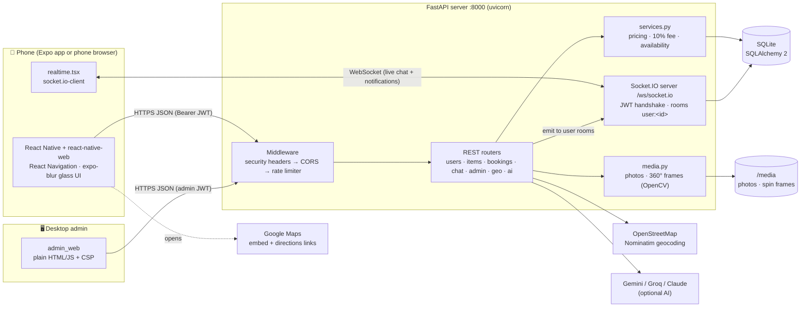
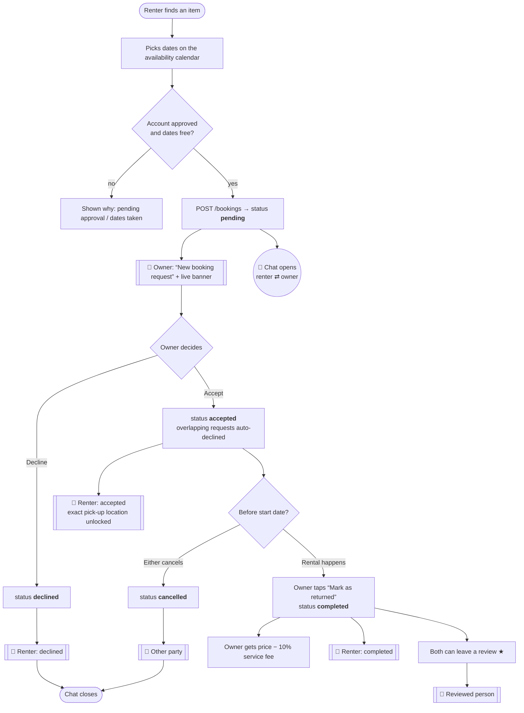
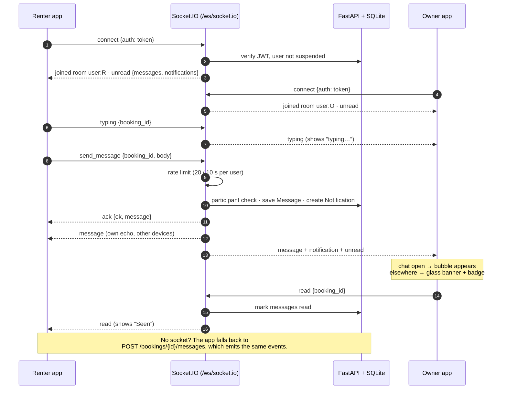
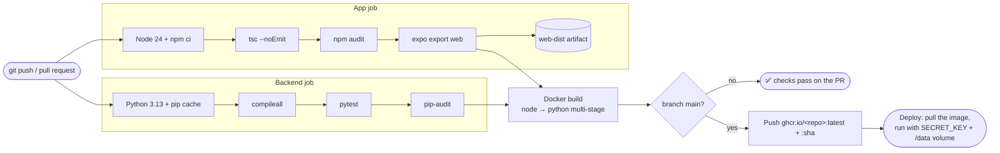
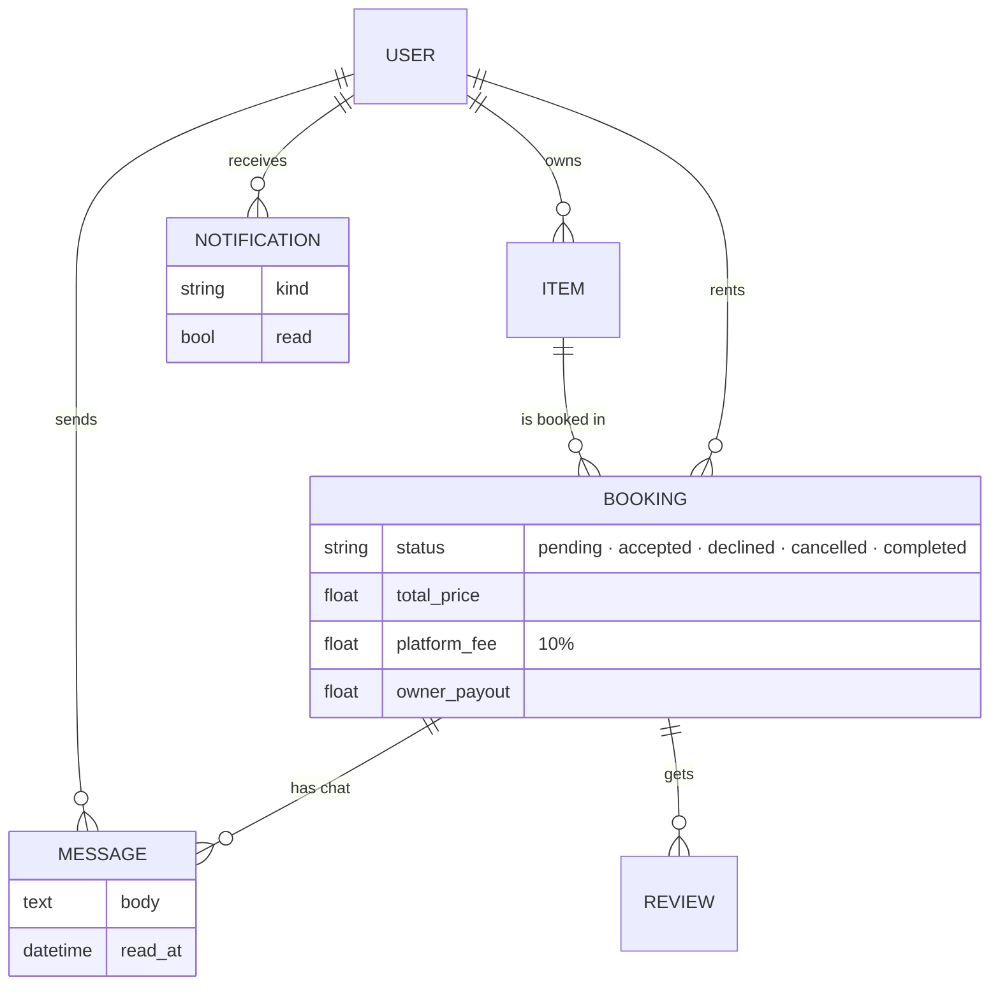

# Architecture — Rentify

GitHub, VS Code (with a Mermaid extension) and most Markdown viewers render the diagrams below.

## 1. Stack

| Layer | Tech |
|---|---|
| App | Expo SDK 58, React Native 0.88, TypeScript, React Navigation, socket.io-client |
| API | FastAPI, Pydantic v2, SQLAlchemy 2, PyJWT (pbkdf2 passwords) |
| Realtime | python-socketio (ASGI), mounted inside FastAPI |
| Data | SQLite file + `/media` folder (Docker volume `/data`) |
| AI | Gemini (free tier) by default; Groq or Claude Haiku optional |
| CI/CD | GitHub Actions → Docker image on GHCR |

## 2. Booking workflow

## 3. Live chat and notifications

Booking events (request, accepted, declined, cancelled, completed, review) are saved as notifications and pushed the same way from the REST endpoints.

## 4. CI/CD pipeline

## 5. Data model (simplified)

